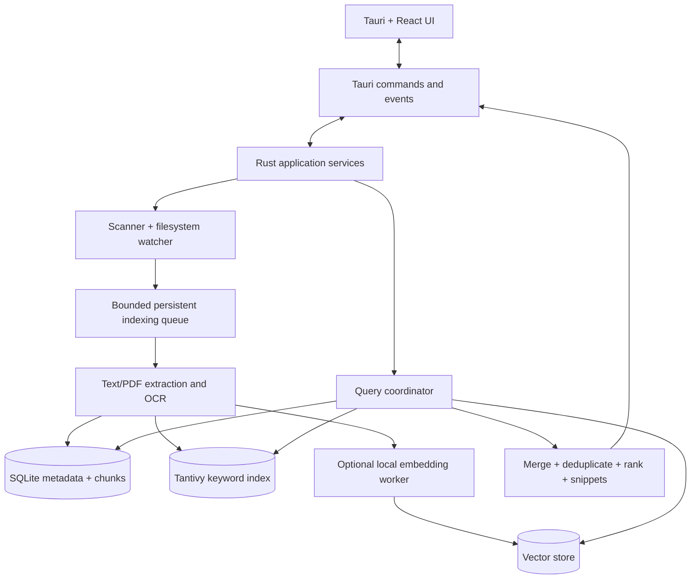

# Sift — AI Build Playbook

> **Paste this entire document into Claude Code or Codex as the project's guiding specification.** Build **one phase at a time**. Do not generate the whole application in one pass. First inspect the repo and propose a concise execution plan for Phase 0; implement only after the plan is clear.

## 1. Product objective

Build **Sift**, a lightweight, offline-first **Ubuntu desktop search app** invoked through a configurable global shortcut. Users choose folders to index and then find files by **filename, exact text inside files, or the meaning of their contents**. Search includes PDFs, plain text/Markdown, common source-code files, and PNG/JPEG screenshots (via OCR). Optional later support: semantic photo search. No cloud calls during normal use.

**Core UX:** Onboarding → choose folders/exclusions → progressive indexing with status → press shortcut → type query → instant filename/keyword results, then optional semantic results → preview relevant snippet/page → open file or reveal location. Search is usable before all indexing finishes.

## 2. Non-negotiable boundaries

- First platform **Ubuntu Linux**. Other OSes, audio/video indexing, cloud accounts, chat/RAG answers, automatic file modification and browser history are **out of scope**.
- **Never upload file content, screenshots, paths, or embeddings** to remote services. No telemetry by default. Models may be downloaded only with explicit user action during setup.
- Index **only user-approved locations**. Exclude `.git`, `node_modules`, build outputs, caches, secrets, inaccessible/system paths by default; offer editable exclusions. Respect symlinks and avoid traversal loops.
- Application must remain useful with **ML disabled**. OCR, embeddings and indexes run in background with bounded resources; no permanent Python server.
- Use stable document/chunk IDs; changed/deleted/renamed files must not leave stale results.
- Keep a working, testable app at the end of each phase. Implement complete behavior, not mock search results, unless the phase explicitly calls for a UI mock.
- Do not pretend benchmarks or accuracy have been measured. Label targets as targets.
- Rust code must handle errors, cancellations and shutdown; do not block the UI thread. Treat file contents as untrusted data.

## 3. Suggested stack

| Layer | Choice |
|---|---|
| Desktop | **Tauri 2**, React, TypeScript, Vite |
| Native backend | **Rust**, modular crates/modules |
| File watching | `notify` with debouncing + periodic reconciliation |
| Metadata | SQLite via `rusqlite` or `sqlx` (choose one and document why) |
| Text search | Tantivy (filename/path/content, BM25 and fuzzy/prefix strategy) |
| OCR | Tesseract for an initial working integration; test PaddleOCR/ONNX later if genuinely advantageous |
| Semantic retrieval | EmbeddingGemma 2 **candidate**, only after validating actual model files, runtime support, memory and licensing; use an adapter so a smaller text encoder can substitute |
| Inference | local CPU-capable runtime, e.g. supported `llama.cpp`/GGUF integration or ONNX, **validate end to end first** |
| Vectors | `sqlite-vec` for MVP, or exact cosine search for a small benchmark corpus before optimizing |
| ML experiments | Python/PyTorch offline, **not required at app runtime** |
| Test tooling | Rust unit/integration tests, frontend tests, fixture-based end-to-end tests, benchmarks |

**Architecture decision:** Treat embedding model family, OCR provider, and vector store as interchangeable interfaces. Do **not** hardcode assumed EmbeddingGemma 2 parameter variants, embedding dimension, instruction prefixes or cross-modal compatibility: verify against official model docs and a real local inference test, then record the chosen model's version, output dimension, normalization, supported modalities, and resource footprint. Keep text-only embedding as a valid first milestone.

## 4. System architecture



**Indexing path:** discover file → filter and fingerprint → enqueue → persist file metadata → extract content and locations → chunk text → write keyword index → optionally OCR/embeddings → mark each modality ready → emit progress.

**Search path:** query → filename/keyword retrieval immediately → optional query embedding/vector retrieval → rank merge (baseline Reciprocal Rank Fusion) → aggregate by file ID → display why matched and exact page/region → open/reveal. Semantic indexing can lag independently.

## 5. Suggested repository layout

```text
sift/
  src/                       # React + TypeScript
    components/              # SearchBar, Results, Preview, Filters, Progress
    pages/                   # Search, Setup, Settings
    services/                # typed Tauri commands/events
  src-tauri/
    src/
      commands/              # safe command API
      scanner/               # scanning, exclusions, stable identity
      watcher/               # changes + reconciliation
      jobs/                  # scheduling, retries, cancellation
      extract/               # plain text, PDF, OCR provider
      indexing/              # Tantivy and chunk indexing
      embeddings/            # model adapter, vectorization
      search/                # lexical, semantic, fusion
      storage/               # migrations, metadata, state
      app/                   # bootstrap, lifecycle, settings
  tests/fixtures/            # deterministic local sample documents/images
  benchmarks/               # accuracy and resource evaluations
  docs/                      # ADRs, setup instructions, limitations
```

## 6. Interfaces and function responsibilities (names are proposed; adjust idiomatically)

**Scanner**
- `scan_roots()` — enumerate approved roots.
- `should_index_path()` — apply exclusions, file limits and symlink policy.
- `read_file_metadata()` — path, MIME, size, modified time and safe fingerprint.
- `schedule_index_job()` — idempotently queue changed files.

**Watcher / scheduling**
- `start_watchers()` — subscribe to approved roots.
- `coalesce_fs_events()` — debounce event storms.
- `reconcile_index()` — find missed creates/moves/deletes.
- `run_index_workers()` — bounded jobs and progress events.
- `retry_or_fail_job()` — bounded retries with clear reason.

**Extraction**
- `extract_text()` — text/Markdown/code ingestion.
- `extract_pdf_pages()` — page-preserving PDF text extraction.
- `extract_ocr_regions()` — image OCR with bounding boxes/confidence.
- `normalize_content()` — normalize without losing provenance.
- `chunk_with_provenance()` — text chunks with page/offset pointers.

**Persistence / indexes**
- `upsert_file()` — stable file record and status.
- `replace_file_chunks()` — idempotent chunk replacement.
- `upsert_text_index()` — Tantivy update.
- `upsert_vectors()` — versioned model output vectors.
- `remove_file_everywhere()` — cleanup all indices on delete.
- `recover_inconsistent_index()` — repair partial failures.

**ML**
- `load_encoder()` — lazy-load validated local model.
- `embed_document_batch()` — generate vectors off the UI thread.
- `embed_query()` — use model's correct query formatting.
- `find_nearest_chunks()` — vector retrieval.
- `unload_encoder()` — configurable idle memory savings.

**Search**
- `search_lexical()` — fast filename and content matching.
- `search_semantic()` — optional embedding retrieval.
- `merge_and_rank()` — deterministic, testable ranking.
- `group_by_file()` — deduplicate chunk matches.
- `make_result_snippet()` — highlight why each result matched.

**Tauri commands**
- `add_root()`, `remove_root()`, `list_roots()` — onboarding/settings.
- `start_scan()`, `get_index_status()` — indexing controls.
- `search_files()` — query and filters.
- `preview_result()` — safe preview and matched position.
- `open_result()`, `reveal_result()` — trusted desktop file actions.
- `set_settings()` — model and resource mode choices.

## 7. Implement step by step (do not skip ahead)

### Phase 0 — Foundation and decisions
**Build:** Set up Tauri 2 + React + Rust, app launches on Ubuntu, logging/errors, CI checks, fixtures, documentation, typed command contract and architecture decision records.

**Acceptance:** Clean checkout builds and opens a window; unit test and lint commands documented and pass.

### Phase 1 — Fast filename search
**Build:** Folder picker, approved roots/exclusions, recursive scanner, SQLite metadata, lightweight filename search, file-open/reveal actions, initial indexing progress and UI search. No embeddings yet.

**Acceptance:** Can add/remove roots, index fixture folders, search names, open correct file, ignore excluded paths, and search while scanning continues. Measure warm latency on a synthetic corpus; no hardcoded results.

### Phase 2 — Robust incremental indexing
**Build:** Watchers, create/modify/delete/move support, debouncing, stable identities, job queue, error/status handling, periodic reconciliation and restart recovery.

**Acceptance:** Changes show up without manual rebuild; old matches disappear after deletes/edits; restart doesn't duplicate entries; CPU is quiet at idle.

### Phase 3 — Full-text documents
**Build:** Tantivy, plain text/Markdown/code ingestion, PDF text by page, chunk provenance, snippets, ranked keyword/content search, file-size safety limits.

**Acceptance:** Search exact phrase inside a PDF/code file and navigate to the correct file/page or location, including after modification.

### Phase 4 — Screenshot OCR
**Build:** PNG/JPEG extraction with local OCR, searchable text and bounding boxes, screenshot preview and match highlight, failure handling.

**Acceptance:** Find a screenshot using an error code not present in its filename; show the matched text. OCR model/engine works fully offline after installation.

### Phase 5 — Semantic retrieval
**Build:** Benchmark one supported small embedding model locally; then assess EmbeddingGemma 2's actual compatible text/image inference support. Adapter, document chunk embeddings, versioned vectors, natural-language queries and lexical + vector fusion. Model download with consent and clear progress; no external runtime calls.

**Acceptance:** A paraphrased query finds an appropriate indexed passage that filename search misses; lexical search still works with the model disabled. Test cold/warm model loading and RAM footprint. Do not enable image embeddings until cross-modal tests pass.

### Phase 6 — Polish, validation and packaging
**Build:** Configurable global shortcut, responsive result list, previews, indexing dashboard, search filters, search cancellation, resources modes (Eco/Performance), graceful shutdown, Ubuntu package, docs and benchmark report.

**Acceptance:** Five realistic queries work end-to-end; fresh-install onboarding, restart, file updates and offline operation pass. Provide reproducible numbers for latency, search quality, indexing throughput, peak/idle RAM and disk index size.

### Optional Phase 7 — ML research (only after a finished MVP)
Evaluate BM25 vs embeddings vs hybrid; chunk sizes; embedding dimensions only if verified supported; OCR vs image embeddings; MRR@10, Recall@10, nDCG@10; optionally fit a small ranking model using train/test separated relevance labels. No need to fine-tune a foundation model.

## 8. Validation data and metrics

Create **small deterministic fixtures first**: several PDFs with known passages, text/code files, screenshots with deliberately planted phrases, ordinary photos, duplicate names in different folders, edited/deleted files, unreadable/corrupted files. Avoid indexing personal/sensitive files in automated tests.

Set **targets**, not promises: warm filename search under 100 ms on a defined synthetic 100k-file benchmark, idle memory under 100 MB if feasible, near-zero idle CPU, graceful progressive indexing, and evidence that semantic search improves at least some paraphrase queries. Track end-to-end UI latency separately from backend lookup latency.

Maintain an explicit `benchmarks/README.md` describing hardware, OS, corpus size and methodology. Never manufacture results or cherry-pick demos as proof of general accuracy.

## 9. Security and privacy

- Roots are opt-in; check canonical paths and denied directories; respect permissions.
- Allow users to remove folders and **delete their indexed data** from all stores.
- Do not silently follow symlinks or read secret/system folders. Index limits for huge or malformed files.
- No remote queries, uploads, telemetry, auto-execution of code, or shell commands derived from file contents.
- Escape/sanitize preview content. Open files only via trusted OS APIs with validated paths.
- Bind models with explicit versions and record their license/distribution requirements.

## 10. Instructions to Claude/Codex for every phase

1. **Read this playbook and inspect the current repository.** Identify the earliest incomplete phase.
2. Before coding, list the phase goal, relevant files/modules, dependencies, risks, and 3–6 acceptance tests. Ask only if a genuinely blocking decision is needed.
3. Implement **only that phase** in small coherent commits or logical changes. Do not restructure unrelated completed components.
4. Add real tests and fixtures; run formatting, linting, type checking, Rust tests and relevant integration checks.
5. Demonstrate actual behavior with commands and observed output. **Never claim tests passed without running them.** If tools cannot run, clearly state that and provide precise manual validation steps.
6. Update `docs/PROGRESS.md` with what's complete, limitations, test results and the next phase. Update architecture documents if design changes.
7. **Stop and request approval** before starting the next phase. Do not implement all phases in one response.
8. When a task seems too big, split it into smaller independently verifiable subtasks, preserving existing working behavior.
9. Prefer existing maintained libraries and correct error handling over clever custom implementations. Verify uncertain APIs/model compatibility from current official documentation before coding.
10. Do not store or print private file contents in logs. Never delete user files as part of indexing tests.

## 11. First instruction to the coding agent

> **Start Phase 0 only.** Inspect the repository, then propose the exact scaffold, package versions, module boundaries, test commands and Ubuntu prerequisites. After the plan, implement and verify Phase 0. Produce `docs/PROGRESS.md`, identify what remains for Phase 1, and stop. Do not implement file search or ML yet.

---

**Definition of done:** Sift is an Ubuntu desktop app that launches via a shortcut, indexes only approved folders, continuously updates its indexes, finds files by filename/content/OCR and (optionally) semantic similarity, displays why results matched, operates offline, and has repeatable performance/quality measurements.
